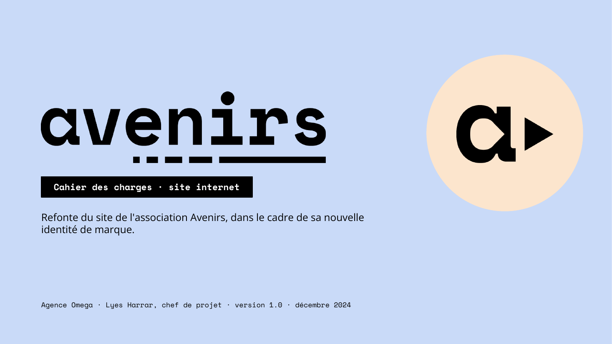
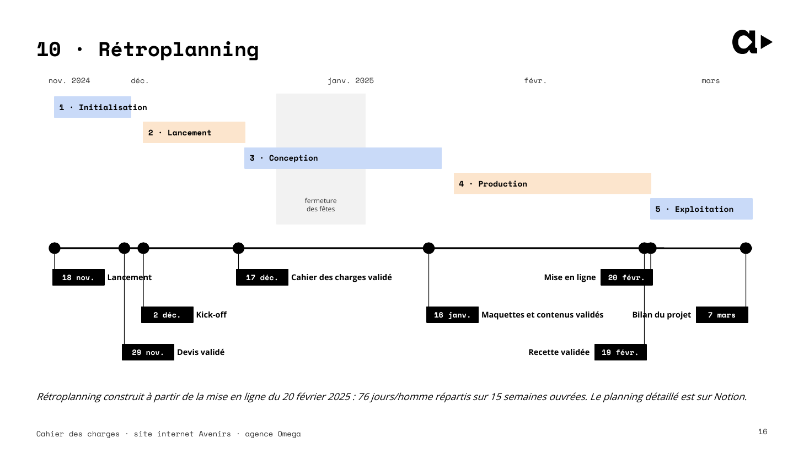
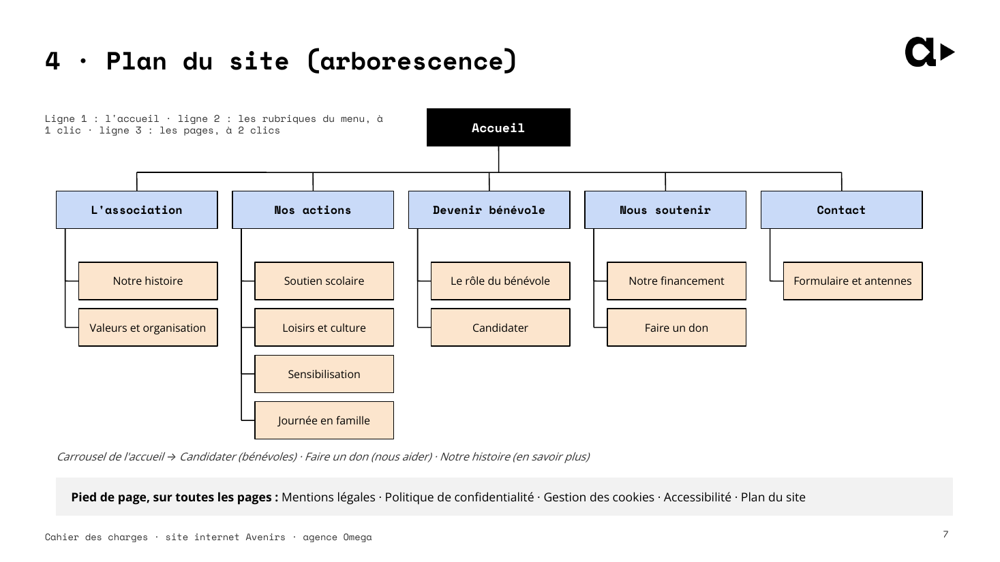
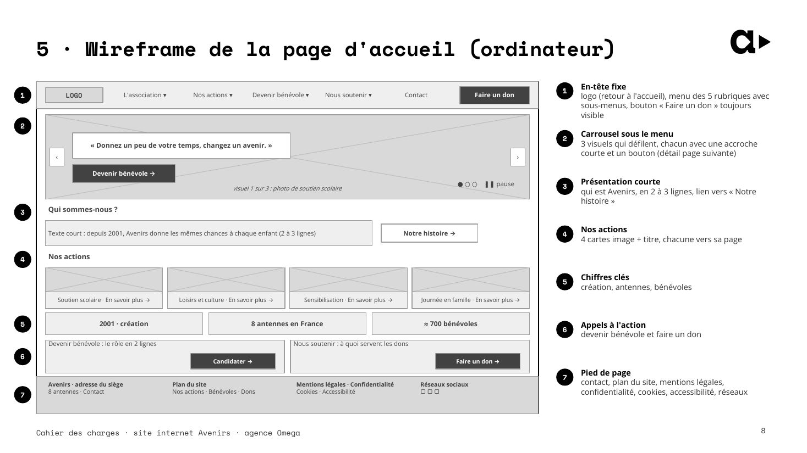
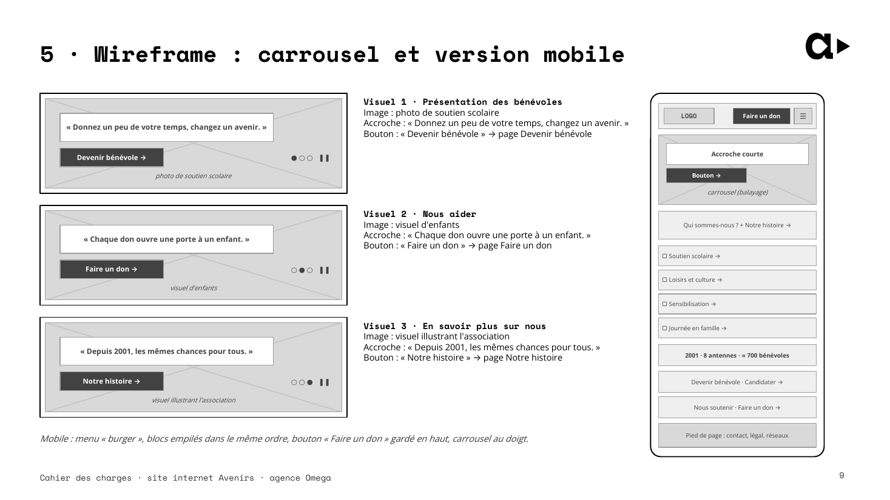
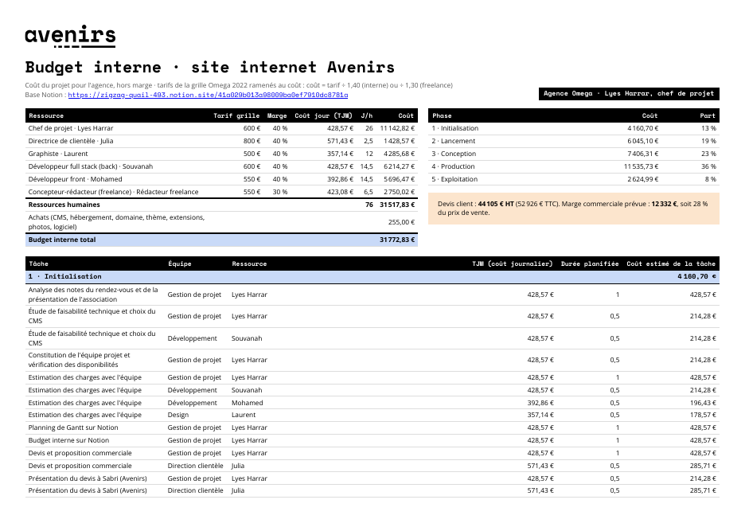
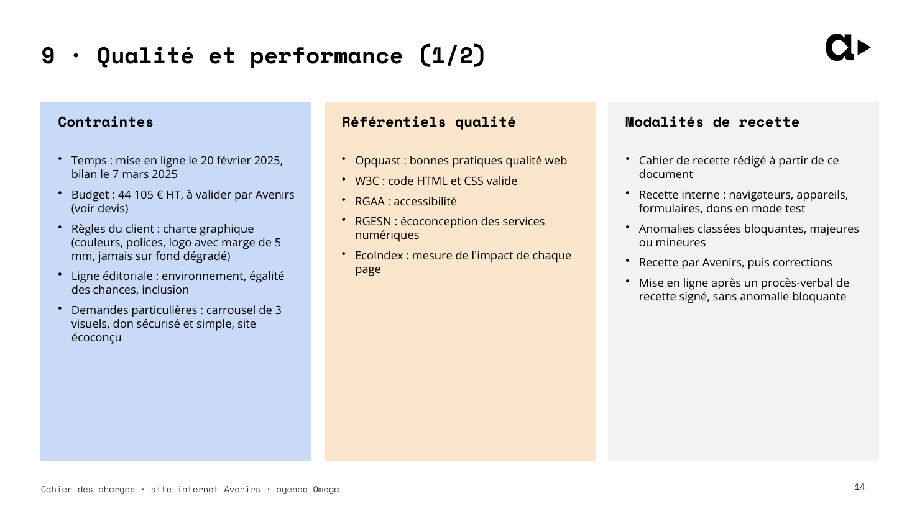
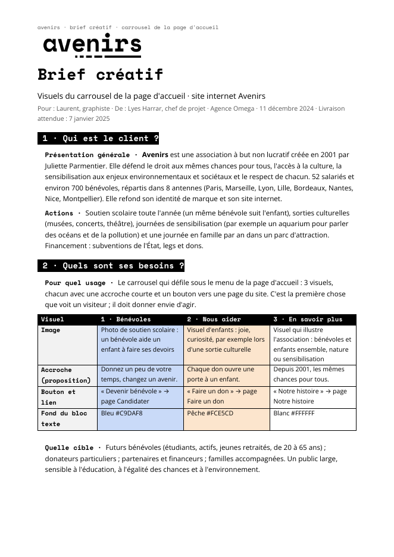

# Refonte du site internet de l'association Avenirs

Cadrage et planification d’un projet web en méthodologie cascade : cahier des charges, brief créatif, budget interne et planning de Gantt.

**Mon rôle :** chef de projet digital côté agence.
**Période couverte par le planning :** 18 novembre 2024 → 7 mars 2025.

---

## Le contexte

Avenirs est une association créée en 2001. Elle accompagne des enfants pour leur donner les mêmes chances : soutien scolaire, sorties culturelles, sensibilisation à l'environnement. Elle compte 8 antennes et environ 700 bénévoles.

L'association change d'identité visuelle et de ligne éditoriale. Elle a besoin d'un nouveau site pour :

- présenter l'association, son histoire et ses actions ;
- expliquer le rôle des bénévoles et en recruter ;
- montrer comment elle se finance et permettre un **don en ligne simple et sécurisé** ;
- être contactée facilement.

Contraintes : un graphisme épuré et écoconçu, le respect de la charte graphique, et un carrousel de 3 visuels sous le menu de la page d'accueil.

## Ce que j'ai produit

| # | Livrable | Format | Contenu |
|---|----------|--------|---------|
| 1 | [Cahier des charges](livrables/Harrar_Lyes_1_cahier_des_charges_112024.pdf) | PowerPoint (17 diapos) | Présentation, enjeux et objectifs, équipe, arborescence, wireframes, spécifications ergonomiques, fonctionnelles et techniques, qualité, KPI, rétroplanning, devis |
| 2 | [Brief créatif](livrables/Harrar_Lyes_2_brief_creatif_112024.pdf) | Word | Brief au graphiste pour les 3 visuels du carrousel |
| 3 | [Budget interne](livrables/Harrar_Lyes_3_budget_interne_112024.pdf) | Notion + PDF | Coût du projet pour l'agence, par tâche et par ressource |
| 4 | [Planning de Gantt](livrables/Harrar_Lyes_4_planning_gantt_112024.pdf) | Notion + PDF | 72 tâches en 5 phases, en jours/homme |

Bases Notion publiques :

- [Planning de Gantt](https://zigzag-quail-493.notion.site/41c029b013a9802e898cd07ac697772d)
- [Budget interne](https://zigzag-quail-493.notion.site/41a029b013a98009ba0ef7910dc8781a)

Les sources éditables (`.pptx`, `.docx`) sont dans le dossier [`livrables/`](livrables/).

---

## La démarche

### 1. Un cycle en cascade en 5 phases

Le périmètre est clair et stable, et le client veut valider chaque étape. J'ai donc choisi une gestion en cascade : chaque phase se termine par une validation d'Avenirs avant de passer à la suivante.

| Phase | Contenu | Jalon |
|-------|---------|-------|
| 1. Initialisation | analyse du besoin, chiffrage, devis | devis validé le 29 nov. 2024 |
| 2. Lancement | kick-off, cahier des charges, brief créatif | cahier des charges validé le 17 déc. 2024 |
| 3. Conception | maquettes, visuels, rédaction des contenus | maquettes validées le 16 janv. 2025 |
| 4. Production | intégration WordPress, dons, formulaires, RGPD, recette | PV de recette le 19 févr. 2025 |
| 5. Exploitation | mise en ligne, formation, garantie, bilan | mise en ligne le 20 févr. 2025 |

### 2. Une équipe resserrée

| Profil | Charge |
|--------|--------|
| Chef de projet (moi) | 26 j/h |
| Développeur back (WordPress, dons, formulaires) | 14,5 j/h |
| Développeur front (intégration, performance) | 14,5 j/h |
| Graphiste (maquettes, visuels) | 12 j/h |
| Concepteur-rédacteur freelance | 6,5 j/h |
| Directrice de clientèle (devis, relation client) | 2,5 j/h |
| **Total** | **76 j/h** |

Organisation :

- un point d'équipe chaque lundi ;
- un comité de validation avec le client à chaque fin de phase ;
- le suivi des tâches dans Notion ;
- les maquettes commentées dans Figma.

### 3. Le site : arborescence et wireframe

Le site est **multipage, sur 3 niveaux** : l'accueil, 5 rubriques, puis leurs pages. Chaque besoin du client a sa page, ce qui est aussi meilleur pour le référencement qu'un site d'une seule page.

Le wireframe montre l'emplacement des éléments, sans graphisme : l'en-tête avec le bouton « Faire un don » toujours visible, le carrousel sous le menu, les actions, les chiffres clés, les appels à l'action (bénévolat et don) et le pied de page légal.

### 4. Les choix techniques

- **WordPress** : l'association pourra modifier ses contenus seule. Le CMS est gratuit et adapté à un budget associatif.
- **HelloAsso** pour les dons : gratuit pour les associations, sécurisé, avec reçus fiscaux automatiques.
- **Un hébergement écoresponsable et un thème léger** pour tenir l'objectif d'écoconception (note EcoIndex A ou B).
- **RGPD** : mentions légales, politique de confidentialité, bandeau de cookies, consentement sur les formulaires et autorisation parentale pour les photos d'enfants.

### 5. Budget interne et devis : deux chiffres différents

| | Montant |
|---|---|
| **Budget interne** (coût pour l'agence, hors marge) | **31 772,83 €** |
| **Devis client** (prix de vente) | **44 105 € HT** (52 926 € TTC) |
| Marge de l'agence | environ 12 300 € (28 % du prix) |

Méthode :

- je pars des tarifs journaliers de la grille de l'agence et je retire la marge pour obtenir le coût réel (÷ 1,40 pour les ressources internes, ÷ 1,30 pour le freelance) ;
- pour chaque tâche, coût = durée planifiée × coût journalier, calculé directement dans Notion ;
- les achats (domaine, hébergement, thème, extension de cache, images, licence Figma) représentent 255 € et sont refacturés à prix coûtant.

### 6. Des KPI pour piloter le projet, pas le site

J'ai défini 8 indicateurs, deux par catégorie, chacun avec son calcul et son objectif :

- **coûts** : écart de coût ≤ 5 %, dépenses hors budget ≤ 2 % ;
- **délais** : tâches en retard ≤ 10 %, 0 jour de retard sur la mise en ligne ;
- **qualité** : satisfaction client ≥ 4/5 à chaque phase, 0 anomalie bloquante à la mise en ligne ;
- **avancement** : ≥ 90 % des tâches prévues terminées à date, jours/homme consommés ≤ 100 % du prévu.

### 7. Le brief créatif

Brief au graphiste pour les 3 visuels du carrousel, avec pour chacun :

- une accroche, un bouton et la page visée ;
- les spécifications techniques : formats, poids, versions ordinateur et mobile ;
- les contraintes de la charte ;
- les contraintes légales : droit à l'image, droits d'auteur, textes alternatifs.

---

## Ce que je retiens

- **Partir de la date de mise en ligne** et remonter le planning (rétroplanning) rend les arbitrages visibles tôt, notamment la fermeture de fin d'année.
- **Séparer budget et devis** dès le départ évite de confondre ce que coûte le projet et ce qu'on le vend.
- **Des KPI de projet** (coûts, délais, qualité, avancement) servent au pilotage hebdomadaire, alors que des indicateurs de site ne mesurent rien pendant la réalisation.
- À refaire, je mettrais **le budget et le planning dans une seule base Notion reliée** : une seule source pour les tâches, les durées et les coûts, au lieu de deux tableaux à garder synchronisés.

---

*Outils : PowerPoint, Word, Notion, Figma.*
